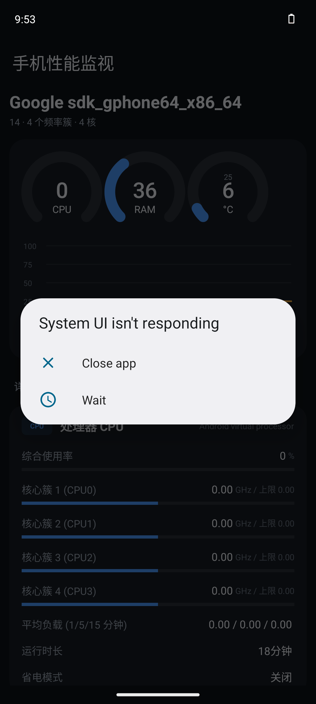

# 手机性能监视 · PhonePerf

一个轻量的 Android 性能数据读取 App，把手机里分散在 `/proc`、`/sys` 和系统服务中的性能指标聚合成一张实时看板。



## 功能

| 分类 | 采集内容 | 数据来源 |
| --- | --- | --- |
| 处理器 CPU | 综合使用率、各核心簇当前/最高频率、平均负载、运行时长、省电模式、芯片型号/架构 | `/proc/stat`、`/sys/devices/system/cpu/cpufreq/policy*`、`/proc/loadavg`、`/proc/cpuinfo` |
| 内存 RAM | 使用率、已用/总计、可用、缓存、缓冲区、Swap、低内存告警、本应用 PSS | `ActivityManager.MemoryInfo`、`/proc/meminfo`、`/proc/swaps` |
| 存储 | 内部存储使用率/剩余、外部存储剩余 | `StatFs` |
| 温度 散热 | 电池温度、系统热状态、各 thermal zone 温度（取最热 6 个） | `ACTION_BATTERY_CHANGED`、`PowerManager`、`/sys/class/thermal` |
| 电池 | 电量、充放电状态、供电来源、电压、电流、实时功率、健康度、电池技术 | `BatteryManager`、`/sys/class/power_supply` |
| 网络 | 网络类型、上下行带宽估算、运营商、蜂窝制式、计费/联网状态 | `ConnectivityManager`、`TelephonyManager` |
| 设备 | 型号、品牌、Android 版本、安全补丁、内核、分辨率、DPI、刷新率、屏幕尺寸 | `Build`、`DisplayMetrics` |

界面包含**三个环形仪表**（CPU / RAM / 最高温度）、**实时折线图**（最近 60 个采样点，每 2 秒刷新一次），以及可下拉刷新的详细指标卡片。

## 技术栈

- Kotlin 1.9.24 + AndroidX + Material 3（**深色主题**，不使用 Compose，构建更快、依赖更少）
- `minSdk 24` / `targetSdk 34` / `compileSdk 34`，Java/Kotlin target 17
- 图表全部**自绘**（`GaugeView`、`LineChartView`），无第三方图表库
- 架构：`View` ↔ `ViewModel(LiveData)` ↔ `PerfRepository` ↔ 各 `XxxReader`
- 所有 IO 在 `Dispatchers.IO` 执行，主线程零阻塞；页面 `onStop()` 自动停止轮询，`onStart()` 恢复

## 目录结构

```
PhonePerf/
├── app/
│   ├── build.gradle.kts            # 模块配置（签名、R8、依赖）
│   └── src/
│       ├── main/
│       │   ├── AndroidManifest.xml
│       │   ├── java/com/example/phoneperf/
│       │   │   ├── data/
│       │   │   │   ├── SysFs.kt            # 安全读取 /sys、/proc 节点
│       │   │   │   ├── Metric.kt           # 数据模型
│       │   │   │   ├── CpuReader.kt        # CPU 频率/温度/负载/SoC
│       │   │   │   ├── MemoryReader.kt     # 内存/存储
│       │   │   │   ├── BatteryReader.kt    # 电池/热状态
│       │   │   │   ├── DeviceReader.kt     # 设备/屏幕/网络
│       │   │   │   └── PerfRepository.kt   # 聚合为卡片
│       │   │   └── ui/
│       │   │       ├── MainActivity.kt
│       │   │       ├── PerfViewModel.kt    # 轮询 + 历史曲线
│       │   │       ├── PerfAdapter.kt      # 多布局列表
│       │   │       ├── GaugeView.kt        # 自绘环形仪表
│       │   │       └── LineChartView.kt    # 自绘折线图
│       │   └── res/                       # 布局、资源、主题
│       └── test/java/com/example/phoneperf/
│           └── LogicTest.kt               # 单元测试
├── keystore/phoneperf-release.jks         # 本地自签名密钥（仅测试用）
├── screenshots/app_running.png            # 运行截图
├── build.gradle.kts / settings.gradle.kts
└── gradlew / gradlew.bat
```

## 构建

需要 **JDK 17** 与 Android SDK（platform 34、build-tools 34.0.0）。

```bash
# 1. 确认 local.properties 中的 sdk.dir 指向本机 SDK
echo "sdk.dir=$ANDROID_HOME" > local.properties

# 2. 编译 Debug APK
./gradlew assembleDebug

# 3. 打 Release 包（已配置本地自签名，无需额外操作）
./gradlew assembleRelease

# 4. 安装到已连接设备
adb install -r app/build/outputs/apk/debug/app-debug.apk

# 5. 运行单元测试
./gradlew test
```

也可以直接用 Android Studio 打开本目录（Gradle JDK 选 17）后点 Run。

构建产物：

| 类型 | 路径 | 说明 |
| --- | --- | --- |
| Debug | `app/build/outputs/apk/debug/app-debug.apk` | 约 5.6 MB，含调试信息 |
| Release | `app/build/outputs/apk/release/app-release.apk` | 约 1.8 MB，R8 压缩 + 资源裁剪，日常使用推荐 |

## 权限说明

- `ACCESS_NETWORK_STATE` / `ACCESS_WIFI_STATE`：读取网络类型与带宽估算
- `READ_PHONE_STATE`：读取运营商名称与蜂窝制式（**运行时申请**；拒绝不影响其他指标，仅这两项显示为空）
- 本应用**不申请**存储、位置、后台定位等敏感权限，也不上传任何数据

## 已知限制

- 部分 ROM（尤其定制系统）会封锁 `/sys/devices/system/cpu/cpufreq` 与 `/sys/class/thermal`，此时对应指标显示 `N/A`，不会崩溃。
- 模拟器（如 `sdk_gphone64`）通常不开放 CPU 频率/使用率与温度传感器，相关指标显示 `N/A` 或 `0`。
- 电流、剩余电量依赖厂商实现，部分机型返回 `Int.MIN_VALUE` 或 `0`，已做过滤。
- 使用率与频率为瞬时采样值，2 秒一次，适合看趋势而非精确基准测试。

## 签名说明

Release 包使用项目内 `keystore/phoneperf-release.jks` 自签名（别名 `phoneperf`，口令 `phoneperf123`）。**该密钥仅用于本地测试，请勿用于应用商店上架**；正式发版请替换为自己的 keystore，并通过 `~/.gradle/gradle.properties` 或环境变量管理口令，不要写进仓库。

## License

Copyright © 2026 小虫工作室. All rights reserved.
